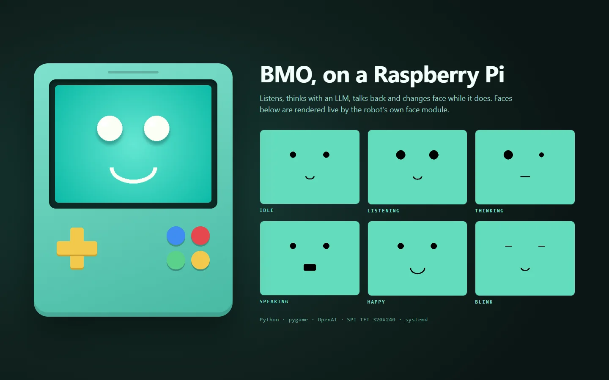

# BMO Robot

A desk-sized BMO (from Adventure Time) running on a Raspberry Pi 4. It listens through a USB mic, answers with an OpenAI-powered personality, speaks back, and draws its face on a small SPI screen, changing expression while it listens, thinks and talks. It also plays music and films on request.



# User Manual

## 1. Hardware Setup

### Suggested Components
- **Raspberry Pi 4 Model B** (2GB+ RAM recommended)
- **TFT Screen (SPI)**: 1.3" to 2.8" (Drivers: ST7789 or ILI9341)
- **USB Microphone**: Mini USB mic
- **Speaker**: 3.5mm Jack or USB Speaker
- **Power Supply**: 5V 3A USB-C

### Wiring (GPIO)
| Screen Pin | RPi Pin | Function |
|------------|---------|----------|
| VCC        | 3.3V    | Power    |
| GND        | GND     | Ground   |
| SCLK       | GPIO 11 | SPI Clock|
| MOSI       | GPIO 10 | SPI Data |
| CS         | GPIO 8  | Chip Select|
| RST        | GPIO 27 | Reset    |
| DC         | GPIO 25 | Data/Command|
| BLU/LED    | GPIO 18 | Backlight (PWM)|

## 2. Software Installation

1. **Clone/Copy Project** to `/home/pi/BMO_Project`
   *(See [DEPLOYMENT.md](./DEPLOYMENT.md) for file transfer instructions)*
2. **Run Setup Script**:
   ```bash
   chmod +x scripts/setup.sh
   ./scripts/setup.sh
   ```
   *Note: This script also generates the BMO face assets in `assets/`.*

3. **Configure Settings**:
   - Copy `config/.env.example` to `config/.env` and add your OpenAI API key.
   - Edit `config/settings.yaml` to tweak volume/sensitivity.

## 3. Running BMO

### Manual Start
```bash
cd BMO_Project
./scripts/start.sh
```

### Auto-Start (Service)
To make BMO start on boot:
```bash
sudo ./scripts/install_service.sh
```

## 4. Features & Voice Commands

- **"Hey BMO"**: Wake word (if configured) or just speak loudly.
- **"Play Music"**: Plays random MP3 from `assets/music`.
- **"Play a Movie"**: Plays video from `assets/films`.
- **"Stop"**: Stops media playback.
- **Chat**: Ask general questions (powered by OpenAI).

## 5. Troubleshooting (Audio)

If audio is quiet or outputting to HDMI instead of Jack:
```bash
sudo raspi-config
# System Options -> Audio -> Headphones
```

For "alsa" errors in logs:
- Ensure `pulseaudio` isn't blocking access.
- Check `~/.asoundrc` settings.

## 6. Offline Mode

If no internet is available:
- STT falls back to Vosk (if installed) or fails.
- OpenAI brain will fail (network required).
- Solution: Install `vosk` pip package and download model to `src/models/`.
